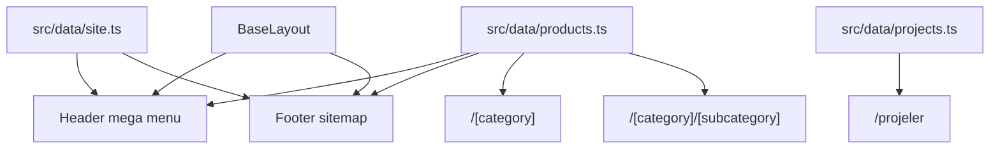

# Makinend site iskeleti

Coming-soon kalkacak. Görsel kaynak Lightwire Worker’ın ilk açılış hali (beyaz header, koyu endüstriyel hero, altın CTA). Ana sayfa içeriği minimal kalır; Worker’ın alt bölümleri (sayaç, newsletter, hiring, video) bu pakette yok.

Kaynak brief: [brief-makinend.md](./brief-makinend.md)

## Fazlar

Sıra zorunlu. Bir faz bitmeden sonrakine geçilmez. Worker homepage bu paketin dışında, **Faz 5** olarak ayrı durur.

### Faz 1 — Temel iskelet ve ana sayfa (tamamlandı)

Coming-soon kalktı. Token, data, ortak layout ve Worker ilk-ekran ana sayfası ayakta.

- `global.css` tokenları (kömür / beyaz / bakır, kare butonlar, uppercase tipografi, `.industrial-surface` doku)
- `src/data/site.ts` (iletişim, 5 menü item; Ürünler `href: null`)
- `src/data/products.ts` — 6 ana + 17 alt kategori, gerçek tanıtım metinleri, helper’lar
- `src/data/projects.ts` (boş dizi + tip)
- `BaseLayout` + `Header` + `Footer` + `PlaceholderMedia` + `ScrollToTop`
- `trailingSlash: 'never'`, `site: https://makinend.com`
- `/`: hero (uppercase başlık, yan yana bakır + outline CTA) + hero’ya 140px binen 3’lü kart şeridi (2 kategori + koyu Projeler paneli)
- Logo ve favicon korundu; placeholder alanlarda logo işareti düşük opaklıkla kullanılıyor
- Menü şeridi hücreleri konteyner genişliğini eşit paylaşır (logo hizasından uca kadar)
- Menü şeridi `sticky`: sayfa kayarken logo satırı yukarı gider, 37px’lik şerit tepeye yapışır. Mobilde şerit gizli olduğu için üst satırın kendisi yapışır.
- Footer açık tema (`--color-surface-muted`), 3 kolon + ortalanmış alt telif şeridi
- 400px’ten sonra görünen yukarı çık butonu (sağ alt, dairesel)

**Doğrulanan:** 1280px’te 4 kolon (266px, eşit yükseklik), 1024px’te 2 kolon, 600px’te tek kolon; yatay taşma yok; mobil hamburger açılıp kapanıyor; build temiz.

**Bu fazda yok:** Ürünler mega menüsü, footer site haritası, ürün route’ları.

### Faz 2 — Header mega menü ve footer site haritası

Faz 1’de header chrome ve footer iletişim bloğu kuruldu; bu fazda tamamlanır.

- Header: Ürünler mega menü (parent tıklanamaz grup başlığı, yalnızca alt kategori linkleri), mobilde accordion
- Footer: Kurumsal / Ürünler (parent linkli) / Projeler / İletişim kolonları
- `© Makinend` + KVKK slot (Faz 1’de hazır)

**Çıktı:** Desktop ve mobilde menü çalışır. Footer sitemap’ten her ürüne gidilir; header’dan yalnızca alt kategorilere.

### Faz 3 — Ürün sayfaları

Data-driven route’lar.

- `/{category}` landing: intro + alt kategori kart grid + placeholder + İncele
- `/{category}/{subcategory}` detay: opsiyonel bölümler, ilgili ürün, CTA
- `Breadcrumb`, `CategoryGrid`, `ProductDetail`, `PlaceholderMedia`, `PageHero`, `CtaBlock`
- `getStaticPaths` — parent 404 olmaz, sahte slug 404 olur

**Çıktı:** 6 ana + 17 alt kategori URL’leri canlı. Lorem yok.

### Faz 4 — Kurumsal sayfalar

- `/hakkimizda` — brief metni eksiksiz
- `/iletisim` — e-posta, telefon, adres (form yok)
- `/projeler` — boş state + kart altyapısı
- `404`

**Çıktı:** Header’daki 5 item’ın hepsi bir sayfaya çıkar.

### Faz 5 — Kalite (bu paketin kapanışı)

- Breadcrumb / title / meta / canonical
- Desktop, tablet, mobil (menü + grid + footer)
- Brief son kontrol listesi

**Çıktı:** Implementasyon paketi kapanır. Worker homepage hâlâ yok.

### Faz 6 — Ana sayfa derinleştirme (sonra)

Worker’ın ilk ekranı Faz 1’de yapıldı. Sonraki adım, aşağıya inen bölümler: hizmet anlatımı, süreç, referans şeridi. Sayaç gibi sayı içeren bloklar ancak gerçek veriyle eklenir.

**Açık ihtiyaç:** hero ve kartlar için gerçek saha/makine fotoğrafı. Şu an nötr placeholder kullanılıyor; asıl görsel etkiyi fotoğraflar verecek.

## Sabit kararlar

- **Stack:** Astro 5 + Cloudflare Workers aynı kalır. `package.json`, `astro.config.mjs`, `wrangler.json` korunur.
- **Silinmeyecekler:** `public/` altındaki logo ve favicon (`logo.png`, `M.png` ve varsa diğer marka dosyaları). Coming-soon metni, split layout ve eski telefon (`+90 530 614 82 41`) kalkar.
- **Görsel kaynak:** [Lightwire Worker](https://templates.framework-y.com/lightwire/pages/index-worker.html) — **ilk açılıştaki ekran** (beyaz header + koyu makine hero + iki CTA). Industry/Factory/Construction varyantı yok. HTML/CSS kopyalanmaz; aynı dil yeniden kurulur.
- **Ana sayfa içeriği:** Worker’ın **ilk ekranı** birebir referans alınır: iki satırlı beyaz header (logo + Teklif Al, altında kutulu menü şeridi), koyu hero, yan yana dolu + outline CTA, hero’ya binen kart şeridi. Worker’ın daha aşağıdaki blokları (sayaç, newsletter, süreç tab, hiring, video) bu pakette **yapılmaz**.
- **Vurgu rengi:** Worker’ın sarı-altını değil, **logodan ölçülen bakır `#b26928`** kullanılır (ikincil sıcak gri `#a49c87`). Sarı, bakır logoyla çakışıyordu.
- **Görseller:** Ürün fotoğrafı yok. Kart ve detaylarda nötr endüstriyel **placeholder blok** (koyu alan + başlık). `image` alanı data’da opsiyonel kalır.
- **Trailing slash:** `trailingSlash: 'never'` — tek standart, Türkçe karaktersiz slug.
- **İletişim (yeni, tüm sitede):** `info@makinend.com`, `+90 531 232 5423` (`tel:+905312325423`), Gebze adresi.

## Mimari



Coming-soon `src/pages/index.astro` silinir (içerik olarak). Yeni sayfalar ortak layout kullanır.

```text
src/
  data/products.ts
  data/site.ts
  data/projects.ts
  layouts/BaseLayout.astro
  components/Header.astro
  components/Footer.astro
  components/Breadcrumb.astro
  components/CategoryGrid.astro
  components/ProductDetail.astro
  components/PageHero.astro
  components/CtaBlock.astro
  components/PlaceholderMedia.astro
  pages/index.astro                    # minimal
  pages/hakkimizda.astro
  pages/iletisim.astro
  pages/projeler.astro
  pages/404.astro
  pages/[category]/index.astro
  pages/[category]/[subcategory].astro
  styles/global.css                    # token + tipografi
```

Dinamik route + `getStaticPaths()`: 6 ana + 17 alt kategori tek şablondan üretilir. Bilinmeyen slug `404` olur; parent slug’lar asla 404 olmaz.

## Merkezi data

Tek ürün ağacı. Header, footer, landing, breadcrumb, related products aynı kaynaktan okur.

```ts
// kavramsal
{
  title: "Taşıyıcı Sistemler",
  slug: "tasiyici-sistemler",
  intro: "Kısa gerçek cümle, lorem yok",
  children: [
    {
      title: "Elevatör Sistemleri",
      slug: "elevator-sistemleri",
      intro: "...",
      // opsiyonel: details, specs, applications, advantages, process, gallery, related
    }
  ]
}
```

Slug’lar brief’tekiyle birebir. Helper’lar: `getCategory`, `getSubcategory`, `getProductHref`, `breadcrumbFor`.

**İçerik kuralı:** Lorem yok. Her alt kategoriye 1–2 cümlelik dürüst tanıtım + her sayfada teklif CTA. Teknik özellik / galeri / proses alanları şemada durur, veri yoksa render edilmez.

`site.ts`: marka, iletişim, header 5 item.

`projects.ts`: `{ slug, title, summary, category?, image? }[]` — şimdilik boş veya 0 kart; boş state hazır.

## Header

5 item: **Ana Sayfa | Ürünler | Projeler | Hakkımızda | İletişim**

- Ana Sayfa → `/` (minimal sayfa)
- **Ürünler:** mega menu. Ana kategoriler **tıklanamaz** (grup başlığı). Yalnızca alt kategori linkleri (`/tasiyici-sistemler/elevator-sistemleri`).
- Desktop: hover mega menu, 6 kolon.
- Mobil: hamburger + accordion. Ana kategori accordion tetikleyici, link değil.

İlk açılış Worker chrome’u: beyaz bar, logo solda, uppercase menü, ince dikey ayırıcı, sağda hamburger (dar ekranda). Mega menu bu iskeletin üzerine biner.

## Footer

Tüm iç sayfalarda ortak. Kolonlar: Kurumsal, Ürünler (parent **linkli** landing + children), Projeler, İletişim. Alt şerit: `© Makinend` + ileride KVKK / sosyal için boş slot.

Header ≠ footer: parent URL footer’da açık, header’da kapalı.

## Sayfalar

**Minimal `/`:** İlk açılış Worker hero kompozisyonu — koyu overlay’li endüstriyel alan (görsel yoksa koyu placeholder), büyük uppercase başlık, kısa beyaz metin, altın dolu **İletişim** + outline **Ürünler / Hakkımızda**. Servis kartı, sayaç, newsletter, süreç, hiring, video yok.

**Kategori landing** `/{category}`: breadcrumb `Ana Sayfa > Ürünler > {Kategori}` (“Ürünler” metin, route yok), intro, alt kategori kart grid (placeholder + başlık + İncele).

**Ürün detay** `/{category}/{sub}`: breadcrumb son kırıma kadar. `ProductDetail` bölümleri data varsa basar: hero, tanıtım, detay, spec, kullanım, avantaj, proses, galeri, ilgili ürün, CTA. İlgili ürün aynı parent’tan diğer children.

**Hakkımızda:** brief metni eksiksiz; bölümler (`Uçtan Uca…`, `Tasarımdan Sahaya…`, kapanış üçlüsü) Worker-benzeri page hero + düz metin kolonları.

**Projeler:** ölçeklenebilir kart grid + boş state. İleride `projects.ts` doldurulunca kartlar çıkar. “Proje” ürün ağacında yok.

**İletişim:** mailto / tel / adres. Form yok (şimdilik).

**404:** layout içinde, ana sayfa + ürünlere dönüş.

## Tasarım dili — Worker ilk açılış

Kaynak ekran: beyaz header, solda logo, sağda hamburger; altta koyu desatüre makine fotoğrafı + overlay; büyük beyaz uppercase başlık; beyaz kısa paragraf; **dolu sarı-altın dikdörtgen CTA**; altında **beyaz outline ghost CTA**. Palet: kömür / siyah / beyaz / tek altın vurgu. Köşeler keskin.

`src/styles/global.css` token’ları bu ekrandan:

- Arka plan kömür (`#1a1a1a` civarı), yüzey beyaz, metin koyu gri
- Vurgu: şablonun sarı-altını yerine logodan ölçülen bakır `#b26928` (bkz. Kararlar)
- Butonlar: dolu bakır + beyaz yazı; ghost beyaz çerçeve
- Kart: beyaz yüzey, ince bakır çizgi, sade hover
- Gradient, yuvarlak oyuncak UI, ağır animasyon yok

### Tipografi — Lightwire ile birebir

Şablondan `getComputedStyle` ile ölçülen değerler (1280px). Rajdhani 700’de biter;
şablonun `900` tanımı da 700 render eder.

| Öğe | Aile | Boyut | Ağırlık | Satır | Harf aralığı |
| --- | --- | --- | --- | --- | --- |
| Gövde, paragraf | Rubik | 15px | 400 | 28px | — |
| `h1` | Rajdhani | 30 → 45px | 700 | 1.1 | — |
| `h2` | Rajdhani | 30px | 700 | 1.1 | — |
| `h3` | Rajdhani | 21px | 700 | 27px | — |
| `h4` | Rajdhani | 18px | 600 | 1.1 | — |
| Footer başlık | Rajdhani | 24px | 700 | 1.1 | — |
| Buton | Rajdhani | 15px | 500 | 23px | — |
| Header CTA / telefon | Rajdhani | 13px | 500 | — | — |
| Küçük link (`.link-small`) | Rajdhani | 12px | 600 | 18px | 0.4px |
| Menü şeridi | Coda | 11px | 400 | 1 | 1px |
| Footer link | Coda | 13px | 400 | 24px | — |

Fontlar `BaseHead` içinden Google Fonts ile tek istekte gelir (`display=swap`).

### Ana sayfa geometrisi — şablondan ölçülen

1280px viewport’ta şablonla eşitlenen değerler:

| Ölçü | Değer |
| --- | --- |
| Hero yüksekliği | 790px |
| Başlığın hero içindeki üst boşluğu | 180px |
| Başlık / metin bloğu genişliği | 540px |
| Başlık → metin | 30px |
| Metin → buton | 50px |
| Buton yüksekliği | 45px |
| Kart şeridi | 3 kolon, kart 339px, aralık 60px |
| Şeridin hero’ya binmesi | 140px |
| Kart iç boşluğu | 30px |
| Kart görseli oranı | 244 / 166 |
| Koyu panel tonu | `#343434` |
| Header üst satırı | 101px |
| Menü şeridi | 38px (1px üst çizgi + 37px hücre) |
| Header toplam | 139px |
| Menü şeridi çizgileri | `#cccccc`, yalnızca üst çizgi (alt kenarı gölge verir) |
| Diğer çizgiler | `#e7e7e7` |

Şeridin 3 kolonu, şablonun “iki içerik kartı + sağda koyu panel” dizilişini birebir
karşılar; bu yüzden ana sayfada iki kategori kartı gösterilir. Şerit `z-index: 1`
almalıdır, aksi halde konumlandırılmış hero binen kısmın üstüne boyanır.

İç sayfa hero’ları aynı overlay + uppercase dilini kullanır (daha kısa). Footer, Worker’ın alt şeridi gibi **açık tema**: kırık beyaz zemin, koyu kömür başlıklar, bakır çizgi işaretli linkler, ortalanmış telif şeridi; kolonlar Makinend sitemap.

`src/components/BaseHead.astro` kalır; her sayfa `title` + `description` geçirir. Favicon `/M.png`. Logo `public/logo.png` — Lightwire logosu yok.

## SEO / routing

- `site` değeri `astro.config.mjs` içinde sonra gerçek domaine çekilir (`example.com` şimdilik).
- Canonical + OG `BaseHead` üzerinden.
- Breadcrumb gerçek href: Ana Sayfa `/`, kategori `/{slug}`, detay `/{parent}/{child}`. Ürünler kırıntısı link değil.

## Bilinçli olarak yapılmayanlar

- Worker’ın ilk ekranından sonraki homepage blokları (sayaç, newsletter, hiring, video, süreç tab)
- Industry / Factory / Construction homepage varyantı
- Yeni kategori uydurmak
- Lorem / sahte teknik spec
- Coming-soon split layout
- Logo silmek
- Form backend, CMS, i18n
